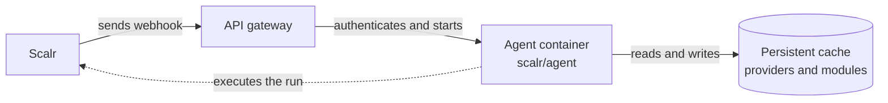

# Scalr Serverless Agent Pool

Product documentation: [Serverless agent pools](https://docs.scalr.io/docs/serverless-agents-pools).

This repository holds Terraform and OpenTofu configurations that deploy a Scalr serverless agent pool on **AWS** or **Azure**.

Each webhook from Scalr starts a container that executes one Terraform run and exits. No container runs while the pool is idle, so you pay only for the compute time of the runs.

## Architecture

The diagram shows which components handle a run request and in which order. Solid arrows are synchronous requests; the dotted arrow is the agent reporting to Scalr during the run.



1. Scalr queues a Terraform run and sends a webhook to the configured endpoint.
2. The API gateway authenticates the request with an API key.
3. The gateway starts a container with the Scalr agent in single-run mode (`SCALR_SINGLE=true`).
4. The agent connects to Scalr, executes the run, and exits.
5. The persistent cache keeps Terraform providers and modules between runs.

Scalr delivers each webhook at least once: up to 3 attempts with a 15 s read timeout, all with the agent task ID in the `Idempotency-Key` header. An endpoint that deduplicates on that header starts one container per task even when Scalr retries. The AWS module deduplicates by passing the key to ECS `RunTask` as `clientToken`. The Azure module does not: Container Apps Jobs have no idempotency token and API Management Consumption has no cache, so a retried delivery can start a second container that finds no task and exits. The platform guides describe both behaviors.

## Platforms

| | AWS | Azure |
|---|---|---|
| **Webhook gateway** | API Gateway (REST API) and Lambda | API Management (Consumption) |
| **Compute** | ECS Fargate | Container Apps Job |
| **Cache storage** | EFS | Azure Files |
| **Deduplicates on `Idempotency-Key`** | Yes, with ECS `RunTask` `clientToken` | No |
| **Cold start** | 10 to 20 s | 5 to 15 s |
| **Platform guide** | [`aws/README.md`](aws/README.md) | [`azure/README.md`](azure/README.md) |

## Prerequisites

- Terraform 1.0 or later, or OpenTofu.
- A Scalr account and an API token. The Scalr provider reads them from the `SCALR_HOSTNAME` and `SCALR_TOKEN` environment variables.
- The AWS CLI or the Azure CLI, authenticated to the target account.

## Quick start

1. Change to the platform directory: `cd aws` or `cd azure`.
2. Set the variables. The Azure directory provides `terraform.tfvars.example` to copy to `terraform.tfvars`. Every AWS variable has a default, so create `terraform.tfvars` only to override one.
3. Run `tofu init`, then `tofu apply`. The apply creates the cloud resources and the Scalr agent pool, and registers the webhook endpoint with Scalr.

The platform guides cover each variable, cost estimates, and troubleshooting.

## Custom container image

To skip provider downloads on the first run, build an image that contains the providers and set it as the container image variable:

```dockerfile
FROM scalr/agent:latest
COPY providers/ /terraform-cache/
```

## Contributing

1. Fork the repository.
2. Create a feature branch.
3. Test your changes.
4. Open a pull request.

## License

MIT License. See [LICENSE](LICENSE).
