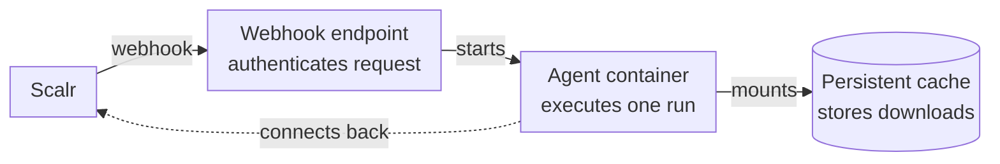

# Scalr Serverless Agent Pool

Product documentation: [Serverless agent pools](https://docs.scalr.io/docs/serverless-agents-pools).

This repository holds Terraform and OpenTofu configurations that deploy a Scalr serverless agent pool on **AWS** or **Azure**.

Each webhook from Scalr starts a container that executes one Terraform run and exits. No container runs while the pool is idle, so you pay only for the compute time of the runs.

## Architecture

Solid arrows show how a webhook starts an agent and how the agent accesses its cache. The dotted arrow shows the agent's separate connection back to Scalr during the run.



1. Scalr queues a Terraform run and sends a webhook to the configured endpoint.
2. The API gateway authenticates the request with an API key.
3. The webhook endpoint starts a container with the Scalr agent in single-run mode (`SCALR_SINGLE=true`), through Lambda on AWS or directly on Azure.
4. The agent connects to Scalr, executes the run, and exits.
5. The persistent cache keeps Terraform providers and modules between runs.

Scalr delivers each webhook at least once: up to 3 attempts with a 15 s read timeout, all with the agent task ID in the `Idempotency-Key` header. An endpoint that deduplicates on that header starts one container per task even when Scalr retries. The AWS module deduplicates by passing the key to ECS `RunTask` as `clientToken`. The Azure module does not: Container Apps Jobs have no idempotency token and API Management Consumption has no cache, so a retried delivery can start a second container that finds no task and exits. The platform guides describe both behaviors.

## Platforms

| | AWS | Azure |
|---|---|---|
| **Webhook gateway** | [API Gateway](https://aws.amazon.com/api-gateway/) (REST API) and [Lambda](https://aws.amazon.com/lambda/) | [API Management](https://azure.microsoft.com/en-us/products/api-management) (Consumption) |
| **Compute** | [ECS Fargate](https://aws.amazon.com/fargate/) | [Container Apps Job](https://learn.microsoft.com/en-us/azure/container-apps/jobs) |
| **Cache storage** | [EFS](https://aws.amazon.com/efs/) | [Azure Files](https://azure.microsoft.com/en-us/products/storage/files) |
| **Agent start time** | 10 to 20 s | 5 to 15 s |
| **Webhook idempotency** | Supported through the [`Idempotency-Key`](https://datatracker.ietf.org/doc/draft-ietf-httpapi-idempotency-key-header/) header. Webhook retries cannot start duplicate containers | Not supported. The Container Apps Job start API has no idempotency key, so webhook retries can start extra agents |
| **Setup and troubleshooting** | [AWS guide](aws/README.md) | [Azure guide](azure/README.md) |

## Prerequisites

- Terraform 1.0 or later, or OpenTofu.
- A Scalr account and an API token. The Scalr provider reads them from the `SCALR_HOSTNAME` and `SCALR_TOKEN` environment variables.
- The AWS CLI or the Azure CLI, authenticated to the target account.

## Quick start

1. Change to the platform directory: `cd aws` or `cd azure`.
2. Set the variables. The Azure directory provides `terraform.tfvars.example` to copy to `terraform.tfvars`. Every AWS variable has a default, so create `terraform.tfvars` only to override one.
3. Run `tofu init`, then `tofu apply`. The apply creates the cloud resources and the Scalr agent pool, and registers the webhook endpoint with Scalr.

The platform guides cover each variable, cost estimates, and troubleshooting.

## Custom container image

To skip provider downloads on the first run, build an image that contains the providers and set it as the container image variable:

```dockerfile
FROM scalr/agent:latest
COPY providers/ /terraform-cache/
```

## Contributing

1. Fork the repository.
2. Create a feature branch.
3. Install [uv](https://docs.astral.sh/uv/), [just](https://just.systems/), [OpenTofu](https://opentofu.org/), and [lychee](https://lychee.cli.rs/), then run `just setup`. The command installs the Python tools and a git hook that runs the checks on each commit.
4. Run `just lint`, `just validate`, and `just test` to check your changes. CI runs the same checks.
5. Open a pull request.

## License

MIT License. See [LICENSE](LICENSE).
