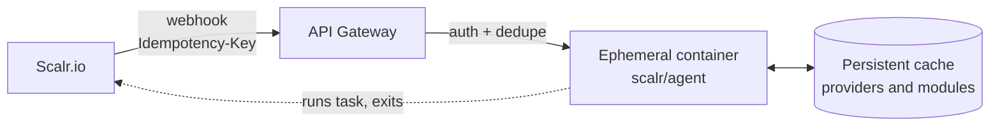

# Scalr Serverless Agent Pool

Terraform/OpenTofu configurations for running Scalr agent pools as serverless workloads on **AWS** or **Azure**.

Each webhook from Scalr spins up an ephemeral container that executes a single Terraform run and exits. Containers scale to zero when idle — you only pay for actual compute time.

## Architecture



1. Scalr needs to execute a Terraform run and sends a webhook to the configured endpoint
2. The API gateway authenticates the request via API key
3. The gateway dedupes the delivery on the `Idempotency-Key` header
4. An ephemeral container starts with the Scalr agent (`SCALR_SINGLE=true`)
5. The agent connects to Scalr, executes the run, and exits
6. Persistent storage caches Terraform providers and modules across runs

Scalr delivers each webhook at least once (up to 3 attempts, 15 s read timeout) with the agent task ID in the `Idempotency-Key` header. The endpoint must dedupe on that header so that retries do not start extra agent containers. Both modules do this: AWS passes the key to ECS `RunTask` as `clientToken`, Azure claims a blob per key before it starts the job.

## Platforms

| | AWS | Azure |
|---|---|---|
| **Webhook gateway** | API Gateway (REST API) + Lambda | API Management (Consumption) |
| **Compute** | ECS Fargate | Container Apps Job |
| **Cache storage** | EFS | Azure Files |
| **Webhook dedupe** | ECS `RunTask` `clientToken` | Blob create-if-absent in the cache storage account |
| **Cold start** | ~10-20s | ~5-15s |
| **Docs** | [`aws/README.md`](aws/README.md) | [`azure/README.md`](azure/README.md) |

## Prerequisites

- Terraform >= 1.0 or OpenTofu
- Scalr account with API access (`SCALR_HOSTNAME` and `SCALR_TOKEN` environment variables)
- Cloud provider CLI authenticated (AWS CLI or Azure CLI)

## Quick Start

```bash
cd aws    # or: cd azure
cp terraform.tfvars.example terraform.tfvars
# Edit terraform.tfvars
tofu init && tofu apply
```

See the platform-specific README for detailed configuration, cost estimates, and troubleshooting.

## Custom Container Image

Build your own image with pre-cached providers:

```dockerfile
FROM scalr/agent:latest
COPY providers/ /terraform-cache/
```

## Contributing

1. Fork the repository
2. Create a feature branch
3. Test your changes
4. Submit a pull request

## License

MIT License - see LICENSE file for details
