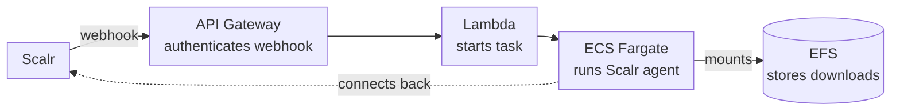

# AWS Serverless Agent Pool

Deploys a Scalr serverless agent pool on AWS. Each Terraform or OpenTofu run executes in its own ECS Fargate task.

Product documentation: [Serverless agent pools](https://docs.scalr.io/docs/serverless-agents-pools).

## Contents

- [Architecture](#architecture)
- [Prerequisites](#prerequisites)
- [Quick start](#quick-start)
- [Configuration](#configuration)
- [Outputs](#outputs)
- [What gets created](#what-gets-created)
- [Security](#security)
- [Cost estimate](#cost-estimate)
- [Troubleshooting](#troubleshooting)

## Architecture

Solid arrows show how a webhook starts an agent and how the agent accesses its cache. The dotted arrow shows the agent's separate connection back to Scalr during the run.



API Gateway authenticates each webhook using the API key in the `x-api-key` header and, by default, checks that the source IP is on the Scalr allowlist. It then invokes Lambda, which calls ECS `RunTask` to start a Fargate task with the Scalr agent in single-run mode (`SCALR_AGENT_SINGLE=true`). The run executes in the Fargate task, so the 15-minute Lambda limit does not apply to it. The agent connects to Scalr, executes the run, and exits. The agent cache is on EFS, so later runs skip the downloads of OpenTofu and Terraform binaries, providers, and modules.

### Webhook delivery

Scalr delivers each webhook at least once, with the agent task ID in the `Idempotency-Key` header, and retries a failed delivery ([webhook reference](https://docs.scalr.io/docs/serverless-webhooks#response-and-retries)). The Lambda function passes a hash of that key to ECS `RunTask` as `clientToken`, so retries within 24 hours start one Fargate task. It returns `202` with the `taskArn`, `400` without the header, and `502` when ECS cannot launch the task.

Each response reports the function version in the `Scalr-Launcher-Version` header and the launcher type, `aws-lambda`, in the `Scalr-Launcher-Type` header. Scalr shows both on the agent pool.

### Task tags

The function sets `startedBy` on each Fargate task to the run ID. To find the task of a run:

```shell
aws ecs list-tasks --cluster <cluster> --started-by <run-id>
```

The function also tags the task with values from the webhook payload:

| Tag | Value |
|---|---|
| `scalr.io/run-id` | Run ID |
| `scalr.io/agent.task-id` | Agent task ID |
| `scalr.io/workspace-id` | Workspace ID |
| `scalr.io/environment-id` | Environment ID |
| `scalr.io/action` | Task type, such as `plan` or `apply` |

To split Fargate costs by workspace in Cost Explorer, activate the tags as cost allocation tags.

## Prerequisites

- Terraform 1.1 or later, or OpenTofu.
- The AWS CLI, authenticated to an account where you can create VPC, API Gateway, Lambda, ECS, EFS, IAM, and Secrets Manager resources.
- A Scalr account, its ID, and an API token.

## Quick start

Replace `v0.1.0` with the latest tag from the [releases page](https://github.com/Scalr/terraform-scalr-serverless/releases):

```shell
git clone --branch v0.1.0 https://github.com/Scalr/terraform-scalr-serverless.git
cd terraform-scalr-serverless/aws
export SCALR_HOSTNAME=example.scalr.io SCALR_ACCOUNT_ID=acc-xxxxxxxx SCALR_TOKEN=<token>
tofu init && tofu apply
```

`AWS_PROFILE` selects another AWS profile. To deploy to another region, set `TF_VAR_aws_region`: the configuration passes `aws_region` to the provider, so `AWS_REGION` has no effect. Every variable has a default; create `terraform.tfvars` only to override one. Resource names must be unique in the account, so set `ecs_cluster_name`, `ecs_task_name`, and `lambda_function_name` for a second deployment.

The apply creates the AWS resources and the Scalr agent pool, and registers the webhook endpoint with Scalr.

## Configuration

| Variable | Description | Default |
|---|---|---|
| `scalr_url` | Scalr URL the agent connects to. Set it when Scalr is not at `https://<account>.scalr.io` | `https://<account>.scalr.io` |
| `aws_region` | AWS region | `us-east-1` |
| `allow_all_ingress` | Accept webhooks from any IP address instead of the Scalr IP allowlist. Use only for testing | `false` |
| `vpc_name` | VPC name prefix | `scalr-agent` |
| `ecs_cluster_name` | ECS cluster name | `scalr-agent-pool-cluster` |
| `ecs_image` | Container image | `scalr/agent:latest` |
| `ecs_limit_cpu` | ECS task CPU units (1024 = 1 vCPU) | `4096` |
| `ecs_limit_memory` | ECS task memory (MB). With 4 vCPU, Fargate accepts 8192 to 30720 | `8192` |
| `ecs_task_stop_timeout` | Seconds ECS waits for the agent to stop before it kills the container | `120` |
| `lambda_timeout` | Lambda timeout (seconds) | `30` |
| `lambda_memory_size` | Lambda memory (MB) | `128` |
| `lambda_runtime` | Lambda Python runtime. The handler requires `python3.11` or later | `python3.13` |
| `agent_environment` | Extra environment variables for the agent container. See [Agent configuration](#agent-configuration) | `{}` |
| `scalr_agent_cache_enabled` | Keep the agent cache on a persistent volume shared by all runs of the pool. See the tip in [Security](#security) | `true` |

### Agent configuration

Set [agent configuration options](https://docs.scalr.io/docs/configuration) with `agent_environment`. Each entry becomes an environment variable of the agent container:

```hcl
agent_environment = {
  SCALR_AGENT_NAME  = "serverless-agent"
  SCALR_AGENT_DEBUG = "true"
}
```

An entry overrides the module's value for the same name, such as `SCALR_AGENT_LOG_FORMAT`. The module always sets `SCALR_AGENT_TOKEN` and `SCALR_AGENT_SINGLE`, and rejects them in `agent_environment`.

The values are stored in plain text in the ECS task definition. Do not put secrets in `agent_environment`.

## Outputs

| Output | Description |
|---|---|
| `webhook_url` | API Gateway endpoint URL |
| `api_key` | API key for webhook authentication (sensitive) |
| `agent_pool_id` | Scalr agent pool ID |
| `agent_token` | Scalr agent token (sensitive) |
| `scalr_allowed_ips` | Scalr IP addresses that the API Gateway policy allows |

## What gets created

| Resource | Purpose |
|---|---|
| VPC and subnets | Network for the ECS tasks |
| API Gateway (REST API) | Webhook endpoint with API key authentication and IP restriction. HTTP APIs (API Gateway v2) do not support resource policies, API keys, or usage plans, so the module uses a REST API |
| Lambda function | Starts one ECS task per webhook delivery |
| ECS cluster and task definition | Run the Scalr agent container on Fargate |
| Secrets Manager secret | Holds the Scalr agent token. The task definition injects it as `SCALR_AGENT_TOKEN` |
| EFS file system and access point | Persistent agent cache: OpenTofu and Terraform binaries, providers, and modules |
| Security groups | Network access control for ECS and EFS |

## Security

- **API key authentication**: every webhook request needs the `x-api-key` header.
- **Idempotent delivery**: repeated deliveries with the same `Idempotency-Key` start one task (ECS `clientToken`).
- **IP restriction**: an API Gateway resource policy accepts requests only from the Scalr IP addresses listed at `scalr.io/.well-known/allowlist.txt`. Set `allow_all_ingress = true` to disable the restriction for testing.
- **Token storage**: the Scalr agent token lives in AWS Secrets Manager. The task definition references it with `valueFrom`, so the token does not appear in the task definition as plain text.
- **VPC isolation**: ECS tasks run in dedicated subnets with security groups.
- **EFS encryption**: EFS encrypts data at rest.

> [!TIP]
> All runs of the pool share the agent cache on EFS, including the OpenTofu and Terraform binaries. This suits a pool whose workspaces trust each other. For workspaces that must stay isolated, use a separate pool or set `scalr_agent_cache_enabled = false`.

## Cost estimate

Estimated monthly cost for 1,000 to 2,000 runs per month:

| Resource | Cost |
|---|---|
| API Gateway | About $1 |
| Lambda | Under $1 |
| ECS Fargate | Billed per vCPU-second and GB-second while tasks run |
| EFS | Billed per GB stored |
| **Total** | **$5 to $20**, depending on run duration |

## Troubleshooting

### Test the webhook manually

```bash
WEBHOOK_URL=$(tofu output -raw webhook_url)
API_KEY=$(tofu output -raw api_key)
curl -s -X POST "$WEBHOOK_URL" \
  -H "x-api-key: $API_KEY" \
  -H "Idempotency-Key: manual-$(date +%s)" \
  -H "Content-Type: application/json" \
  -d '{}'
```

A successful request returns `202` with the ECS task ARN. Send the request twice with the same `Idempotency-Key`. The second call returns the same task ARN and does not start a second task.

### Check ECS task status

```bash
aws ecs list-tasks --cluster scalr-agent-pool-cluster --desired-status RUNNING
aws ecs describe-tasks --cluster scalr-agent-pool-cluster --tasks <task-arn>
```

### View ECS task logs

```bash
aws logs filter-log-events --log-group-name /ecs/scalr-agent-pool-cluster
```

### Check Lambda invocations

The function writes JSON logs. Each record of a webhook delivery has the `idempotency_key` field, so you can find the records for one Scalr agent task:

```bash
aws logs filter-log-events --log-group-name /aws/lambda/scalr-agent \
  --filter-pattern '{ $.idempotency_key = "<agent-task-id>" }'
```

### View Scalr IP allowlist

```bash
curl -s https://scalr.io/.well-known/allowlist.txt
```

### Common issues

| Symptom | Cause | Fix |
|---|---|---|
| `403` on the webhook | The source IP is not in the Scalr allowlist | Compare the source IP with the allowlist. For testing, set `allow_all_ingress = true` |
| `403` with a valid API key | The key does not match the deployed one | Read the key again: `tofu output -raw api_key` |
| Lambda timeout | The ECS `RunTask` call took longer than `lambda_timeout` | Increase `lambda_timeout` |
| Webhook returns `202` but no new task starts | A task for this `Idempotency-Key` started within the last 24 hours | Expected. Send a new key to start another task |
| `ECS could not launch the task` in Lambda logs | ECS rejected the launch | Read the `reason` in the logged `failures` list |
| `ConflictException` in Lambda logs | A retry reused a client token with different launch parameters, for example after a new task definition revision | Keep launch settings stable while Scalr retries. The webhook returns `502` |
| Agent exits right after it starts, with `already taken, canceled or finished` in its log | The run was canceled, or another agent took the task, before this container connected | Expected. The container stops instead of waiting idle |
| ECS task fails to start | Image pull error or resource limits | Check the CloudWatch logs and verify that the image exists |
| Slow first run | The agent downloads OpenTofu or Terraform and the providers into the empty EFS cache | Expected. Later runs use the cache |
