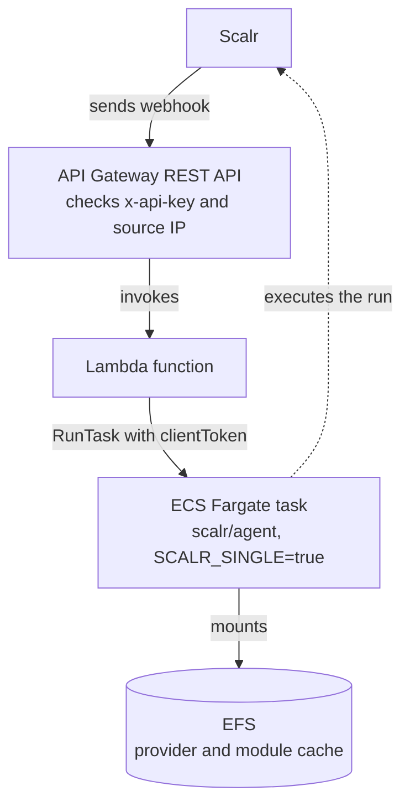

# AWS Serverless Agent Pool

Deploys a Scalr serverless agent pool on AWS. Each Terraform or OpenTofu run executes in its own ECS Fargate task.

Product documentation: [Serverless agent pools](https://docs.scalr.io/docs/serverless-agents-pools).

## Architecture

The diagram shows the path of one run request. Each solid arrow is a synchronous call; the dotted arrow is the agent reporting to Scalr during the run.



API Gateway authenticates the webhook and invokes the Lambda function. The function starts an ECS Fargate task with the Scalr agent. The agent connects to Scalr, executes the run, and exits. The EFS file system keeps providers and modules between runs, so later runs skip those downloads.

### Webhook delivery and idempotency

Scalr delivers each webhook at least once: up to 3 attempts with a 15 s read timeout, all with the same `Idempotency-Key` header (the agent task ID). An endpoint that does not deduplicate on that header starts an extra agent container for every retry.

The Lambda function passes `Idempotency-Key` to ECS `RunTask` as `clientToken`. ECS remembers a client token for up to 24 hours per cluster and returns the original task for repeated calls, so one key starts at most one Fargate task. A delivery without the header always starts a task.

The function returns:

| Status | Meaning |
|---|---|
| `200` | The function started a task, or a task for this key already exists |
| `503` | ECS could not place the task. The body lists the ECS `failures` |
| `502` | The ECS API call failed. API Gateway returns this status when the function raises an error. Scalr retries |

ECS also remembers a placement failure for the client token. A retry with the same `Idempotency-Key` returns the same `503` without a new placement attempt.

## Prerequisites

- Terraform 1.0 or later, or OpenTofu.
- The AWS CLI, authenticated to an account where you can create VPC, API Gateway, Lambda, ECS, EFS, IAM, and Secrets Manager resources.
- A Scalr account and an API token. The Scalr provider reads them from the `SCALR_HOSTNAME` and `SCALR_TOKEN` environment variables.

## Quick start

Every variable has a default. Create `terraform.tfvars` only to override one, then apply:

```bash
cd aws
tofu init
tofu apply
```

The apply creates the AWS resources and the Scalr agent pool, and registers the webhook endpoint with Scalr.

## Configuration

| Variable | Description | Default |
|---|---|---|
| `aws_region` | AWS region | `us-east-1` |
| `allow_all_ingress` | Accept webhooks from any IP address instead of the Scalr IP allowlist. Use only for testing | `false` |
| `vpc_name` | VPC name prefix | `scalr-agent` |
| `ecs_cluster_name` | ECS cluster name | `scalr-agent-pool-cluster` |
| `ecs_image` | Container image | `scalr/agent:latest` |
| `ecs_limit_cpu` | ECS task CPU units (1024 = 1 vCPU) | `2048` |
| `ecs_limit_memory` | ECS task memory (MB) | `4096` |
| `ecs_task_stop_timeout` | Seconds ECS waits for the agent to stop before it kills the container | `120` |
| `lambda_timeout` | Lambda timeout (seconds) | `30` |
| `lambda_memory_size` | Lambda memory (MB) | `128` |
| `lambda_runtime` | Python runtime version | `python3.11` |

## Outputs

| Output | Description |
|---|---|
| `webhook_url` | API Gateway endpoint URL |
| `api_key` | API key for webhook authentication (sensitive) |
| `agent_pool_id` | Scalr agent pool ID |
| `agent_token` | Scalr agent token (sensitive) |
| `scalr_allowed_ips` | Scalr IP addresses that the API Gateway policy allows |

## What gets created

| Resource | Purpose |
|---|---|
| VPC and subnets | Network for the ECS tasks |
| API Gateway (REST API) | Webhook endpoint with API key authentication and IP restriction. HTTP APIs (API Gateway v2) do not support resource policies, API keys, or usage plans, so the module uses a REST API |
| Lambda function | Starts one ECS task per webhook delivery |
| ECS cluster and task definition | Run the Scalr agent container on Fargate |
| Secrets Manager secret | Holds the Scalr agent token. The task definition injects it as `SCALR_TOKEN` |
| EFS file system and access points | Persistent Terraform provider and module cache |
| Security groups | Network access control for ECS and EFS |

## Security

- **API key authentication**: every webhook request needs the `x-api-key` header.
- **Idempotent delivery**: repeated deliveries with the same `Idempotency-Key` start one task (ECS `clientToken`).
- **IP restriction**: an API Gateway resource policy accepts requests only from the Scalr IP addresses listed at `scalr.io/.well-known/allowlist.txt`. Set `allow_all_ingress = true` to disable the restriction for testing.
- **Token storage**: the Scalr agent token lives in AWS Secrets Manager. The task definition references it with `valueFrom`, so the token does not appear in the task definition as plain text.
- **VPC isolation**: ECS tasks run in dedicated subnets with security groups.
- **EFS encryption**: EFS encrypts data at rest.

## Cost estimate

Estimated monthly cost for 1,000 to 2,000 runs per month:

| Resource | Cost |
|---|---|
| API Gateway | About $1 |
| Lambda | Under $1 |
| ECS Fargate | Billed per vCPU-second and GB-second while tasks run |
| EFS | Billed per GB stored |
| **Total** | **$5 to $20**, depending on run duration |

## Troubleshooting

### Test the webhook manually

```bash
WEBHOOK_URL=$(tofu output -raw webhook_url)
API_KEY=$(tofu output -raw api_key)
curl -s -X POST "$WEBHOOK_URL" \
  -H "x-api-key: $API_KEY" \
  -H "Idempotency-Key: manual-$(date +%s)" \
  -H "Content-Type: application/json" \
  -d '{}'
```

Send the request twice with the same `Idempotency-Key`. The second call returns `200` and does not start a second task.

### Check ECS task status

```bash
aws ecs list-tasks --cluster scalr-agent-pool-cluster --desired-status RUNNING
aws ecs describe-tasks --cluster scalr-agent-pool-cluster --tasks <task-arn>
```

### View ECS task logs

```bash
aws logs filter-log-events --log-group-name /ecs/scalr-agent-pool-cluster
```

### Check Lambda invocations

The function writes JSON logs. Each record of a webhook delivery has the `idempotency_key` field, so you can find the records for one Scalr agent task:

```bash
aws logs filter-log-events --log-group-name /aws/lambda/scalr-agent \
  --filter-pattern '{ $.idempotency_key = "<agent-task-id>" }'
```

### View Scalr IP allowlist

```bash
curl -s https://scalr.io/.well-known/allowlist.txt
```

### Common issues

| Symptom | Cause | Fix |
|---|---|---|
| `403` on the webhook | The source IP is not in the Scalr allowlist | Compare the source IP with the allowlist. For testing, set `allow_all_ingress = true` |
| `403` with a valid API key | The key does not match the deployed one | Read the key again: `tofu output -raw api_key` |
| Lambda timeout | The ECS `RunTask` call took longer than `lambda_timeout` | Increase `lambda_timeout` |
| Webhook returns `200` but no new task starts | A task for this `Idempotency-Key` started within the last 24 hours | Expected. Send a new key to start another task |
| ECS task fails to start | Image pull error or resource limits | Check the CloudWatch logs and verify that the image exists |
| Slow first run | The agent downloads providers into the empty EFS cache | Expected. Later runs use the cached providers |
