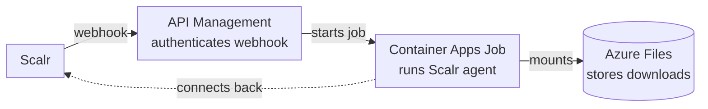

# Azure Serverless Agent Pool

Deploys a Scalr serverless agent pool on Azure. Each Terraform or OpenTofu run executes in its own Container Apps Job execution.

Product documentation: [Serverless agent pools](https://docs.scalr.io/docs/serverless-agents-pools).

## Architecture

Solid arrows show how a webhook starts an agent and how the agent accesses its cache. The dotted arrow shows the agent's separate connection back to Scalr during the run.



API Management (APIM) authenticates each webhook using the subscription key in the `Ocp-Apim-Subscription-Key` header. It uses its managed identity to start a Container Apps Job execution. The agent container runs in single-run mode (`SCALR_AGENT_SINGLE=true`). It starts in 5 to 15 seconds, connects to Scalr, executes the run, and exits. The Azure Files shares keep providers and modules between runs, so later runs skip those downloads.

### Webhook delivery and idempotency

The Container Apps Job start API has no idempotency key, so this module does not deduplicate deliveries. A retried delivery can start an extra agent that finds no task and exits. See the [webhook reference](https://docs.scalr.io/docs/serverless-webhooks#response-and-retries).

## Prerequisites

- Terraform 1.0 or later, or OpenTofu.
- The Azure CLI, signed in with `az login`, or another [azurerm authentication method](https://registry.terraform.io/providers/hashicorp/azurerm/latest/docs).
- A Scalr account and an API token. The Scalr provider reads them from the `SCALR_HOSTNAME` and `SCALR_TOKEN` environment variables.

## Quick start

1. Copy the example variables and edit them for your environment:

   ```bash
   cd azure
   cp terraform.tfvars.example terraform.tfvars
   ```

2. Run `tofu init`, then `tofu apply`. The apply creates the Azure resources and the Scalr agent pool, and registers the webhook endpoint with Scalr.

The first apply takes 10 to 15 minutes because APIM provisioning is slow. Later applies take a few minutes.

## Configuration

| Variable | Description | Default |
|---|---|---|
| `azure_location` | Azure region | `eastus` |
| `resource_group_name` | Resource group name | `scalr-serverless-rg` |
| `name_prefix` | Prefix for all resource names | `scalr-agent` |
| `agent_pool_name` | Scalr agent pool name | `azure-serverless` |
| `container_image` | Agent container image | `scalr/agent:latest` |
| `container_cpu` | CPU cores per job execution | `4` |
| `container_memory_gb` | Memory (GB) per job execution. Container Apps requires 2 GB per CPU core | `8` |
| `job_timeout` | Seconds a job execution can run before Container Apps stops it | `3600` |
| `max_parallel_runs` | Maximum number of concurrent job executions | `10` |
| `agent_environment` | Extra environment variables for the agent container. See [Agent configuration](#agent-configuration) | `{}` |

### Agent configuration

Set [agent configuration options](https://docs.scalr.io/docs/configuration) with `agent_environment`. Each entry becomes an environment variable of the agent container:

```hcl
agent_environment = {
  SCALR_AGENT_NAME  = "serverless-agent"
  SCALR_AGENT_DEBUG = "true"
}
```

An entry overrides the module's value for the same name, such as `SCALR_AGENT_LOG_FORMAT`. The module always sets `SCALR_AGENT_TOKEN` and `SCALR_AGENT_SINGLE`, and rejects them in `agent_environment`.

The values are stored in plain text in the Container Apps Job. Do not put secrets in `agent_environment`.

## Outputs

| Output | Description |
|---|---|
| `webhook_url` | APIM endpoint URL. The module registers it with the Scalr agent pool |
| `api_key` | APIM subscription key (sensitive) |
| `agent_pool_id` | Scalr agent pool ID |
| `container_app_job` | Container Apps Job name |
| `resource_group_name` | Azure resource group name |

## What gets created

| Resource | Purpose |
|---|---|
| Resource group | Holds every resource of the deployment |
| Virtual network and subnet | Network for the Container Apps environment, with a network security group |
| Container Apps environment | Hosts the job |
| Container Apps Job | Runs the Scalr agent on demand |
| API Management (Consumption) | Webhook endpoint with subscription key authentication |
| Container Registry (Basic) | Mirrors the agent image from Docker Hub |
| Storage account and file shares | Persistent Terraform provider and module cache |

## Cost estimate

Estimated monthly cost for 1,000 to 2,000 runs per month:

| Resource | Cost |
|---|---|
| API Management (Consumption) | Free for the first 1 million calls per month |
| Container Apps Job | About $0.000012 per vCPU-second and $0.000002 per GiB-second while executions run |
| Container Registry (Basic) | About $5 |
| Storage account (50 GB LRS) | About $1 |
| **Total** | **$10 to $20**, depending on run duration |

Container Apps Jobs have a free grant of 180,000 vCPU-seconds and 360,000 GiB-seconds per subscription per month.

## Troubleshooting

### Check job executions

```bash
az containerapp job execution list \
  --resource-group scalr-serverless-rg \
  --name scalr-agent-agent -o table
```

### View container logs

```bash
az containerapp logs show \
  --resource-group scalr-serverless-rg \
  --name scalr-agent-agent --type system
```

### Test the webhook manually

```bash
API_KEY=$(tofu output -raw api_key)
WEBHOOK_URL=$(tofu output -raw webhook_url)
curl -s -X POST "$WEBHOOK_URL" \
  -H "Ocp-Apim-Subscription-Key: $API_KEY" \
  -H "Content-Type: application/json" -d '{}'
```

A successful request returns HTTP `200` with the job execution ID. Each request starts a new execution; the module does not deduplicate on `Idempotency-Key`.

### Stop a running execution

```bash
az rest --method POST --uri \
  "https://management.azure.com/subscriptions/{sub_id}/resourceGroups/scalr-serverless-rg/providers/Microsoft.App/jobs/scalr-agent-agent/executions/{execution_name}/stop?api-version=2024-03-01"
```

### Common issues

| Symptom | Cause | Fix |
|---|---|---|
| `MissingSubscriptionRegistration` | The `Microsoft.App` resource provider is not registered | The azurerm provider registers it (`resource_provider_registrations = "extended"`). With a restricted service principal, register it yourself: `az provider register --namespace Microsoft.App` |
| `401` on the webhook | The subscription key does not match the deployed one | Read the key again: `tofu output -raw api_key` |
| The job starts but the agent picks up no run | Wrong agent token or Scalr URL | Check the `SCALR_URL` and `SCALR_AGENT_TOKEN` environment variables of the job |
| Slow first webhook call, about 5 s | APIM Consumption cold start | Expected after an idle period |
| Extra job execution that exits without a run | Scalr retried a delivery after an execution had already started | Expected. See Webhook delivery and idempotency |

## Security

- **Webhook authentication**: every request needs the APIM subscription key in the `Ocp-Apim-Subscription-Key` header. The URL carries no secret.
- **Job start**: APIM starts executions with its system-assigned managed identity, which has the Contributor role on the job resource only.
- **Registry**: the Container Registry (Basic) uses admin credentials. The job pulls images over the Azure network.
- **Storage**: the storage account requires TLS 1.2, disables public blob access, and enables soft delete.
- **Network**: the Container Apps subnet has a network security group and is delegated to `Microsoft.App/environments`.
